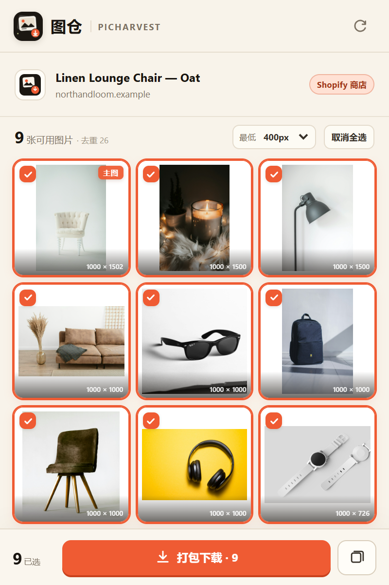
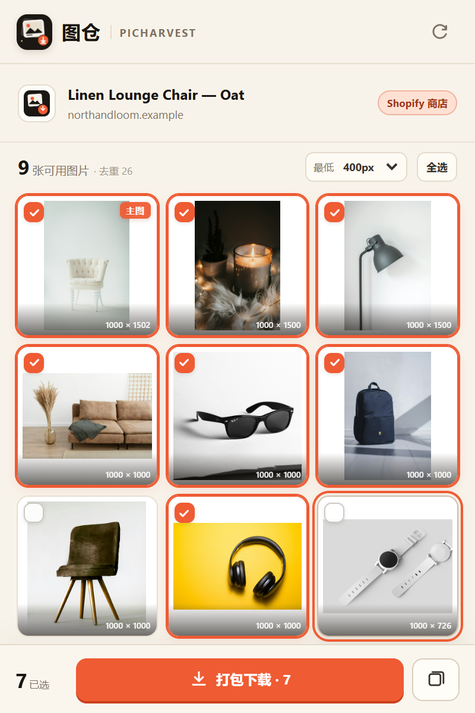
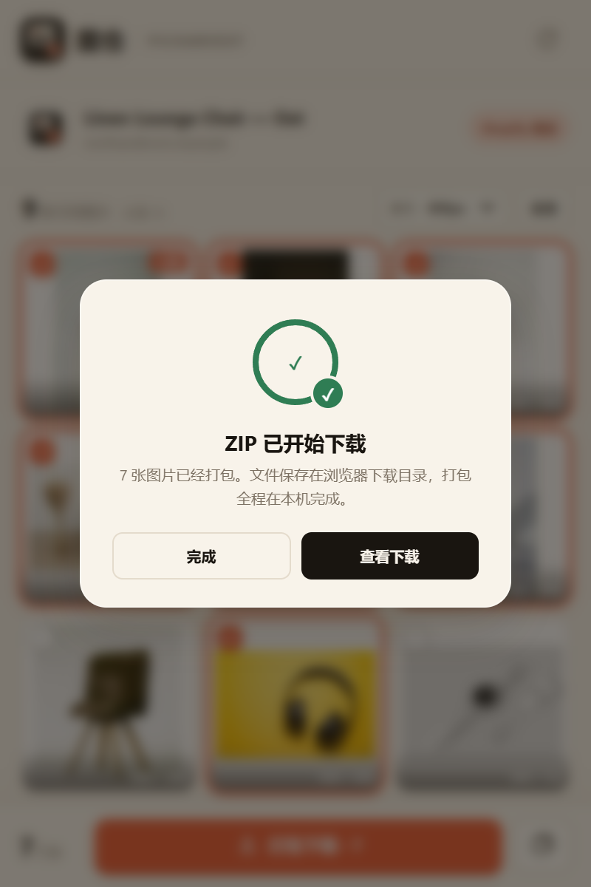

# 图仓 PicHarvest

**电商图片下载器 · 把商品图一次收齐。**

一个真实可安装的 Chrome / Edge Manifest V3 扩展，以及一套中文产品介绍站。打开商品详情页，点击图仓，它会在本地扫描页面图片，自动去重、优先还原高清原图，然后打包 ZIP 或逐张下载。

- **在线站点**：https://picharvest-2026.surge.sh
- **版本**：v1.0.0（Chrome / Edge 116+）
- **安装包**：`site/downloads/picharvest-extension-v1.0.0.zip`
- **源码包**：`site/downloads/picharvest-source-v1.0.0.zip`
- **SHA-256**：`e29a4b79f7f659126b468086a5ef37b0877642cf45e9f25856b869d91c3597ba`
- **源码校验**：`site/downloads/SOURCE-SHA256.txt`
- **许可**：MIT


## 使用截图

| 扫描商品页 | 选择图片 | ZIP 下载 |
| --- | --- | --- |
|  |  |  |

截图来自 Chromium 156 实际加载扩展的运行结果，测试商品页为演示数据。

---

## 功能

- **原图优先**：识别 Amazon、淘宝/1688、Shopify、eBay、Etsy、Walmart、SHEIN、京东等 CDN 的尺寸后缀，尽量还原原始文件。
- **智能去重**：同一张图的缩略图、`srcset`、webp、不同尺寸地址会合并，保留最大尺寸与最佳来源。
- **不止 ``**：同时读取 `srcset`、JSON-LD、Open Graph、懒加载属性、CSS 背景图、视频封面和 Shopify 产品 JSON。
- **两种下载方式**：
  - ZIP：在隐藏的 offscreen 页面中用 JSZip 生成，不转码、不压缩画质。
  - 逐张：交给浏览器下载器，适合带登录态 / 防盗链的 CDN。
- **按商品命名**：ZIP 内按商品标题建文件夹，图片按 `001_描述.jpg` 命名。
- **本地处理**：没有账号、没有后端、没有统计 SDK。图片从原站直接下载到浏览器。
- **真实 UI**：站点筛选、主图标记、尺寸提示、勾选、全选、最低尺寸过滤、进度与失败跳过提示。

## 支持平台

Amazon、Shopify（含自定义域名）、淘宝、天猫、1688、AliExpress、Alibaba、Shopee、eBay、Walmart、Etsy、Temu、SHEIN、京东、拼多多、小红书、抖音商城、TikTok Shop、Wish。未列入的电商页面走通用抓取。

## 安装（本地包）

1. 下载 `picharvest-extension-v1.0.0.zip` 并解压到一个固定文件夹。
2. Chrome 打开 `chrome://extensions`；Edge 打开 `edge://extensions`。
3. 开启右上角「开发者模式」。
4. 点击「加载已解压的扩展程序」，选择解压后的文件夹。
5. 打开任意商品详情页，点击工具栏中的图仓图标（或按 `Alt+Shift+H`）。

## 开发

```bash
npm install
npm run build       # 合并 content script、复制 JSZip、生成安装包和 SHA-256
npm run build:source # 生成可下载的源码 ZIP（site/downloads）
npm test            # jsdom 提取器单元测试
npm run serve       # http://127.0.0.1:4173 本地预览站点
npm run test:e2e    # 在 Chromium 中真实加载扩展，验证扫描 / ZIP / 逐张下载
npm run preview     # 生成桌面与移动端站点截图
```

Playwright 浏览器安装：`npx playwright install chromium`

### 目录结构

```
extension/
  manifest.json          MV3 清单
  popup.html/css/js      扩展弹窗 UI
  src/extractor.js       页面图片提取核心（UMD，可在 Node 中测试）
  src/content.js         内容脚本运行时（按需注入）
  content.js             build 生成的合并内容脚本
  background.js          Service Worker：调度 ZIP / 逐张下载
  offscreen.html/js      JSZip 打包与 blob URL 生成
  lib/jszip.min.js       本地依赖，无 CDN
  icons/                 PNG 图标
site/
  index.html             产品介绍页（含真实使用截图）
  privacy.html           隐私说明
  404.html               404
  assets/                样式、脚本、截图、演示图、OG 图、usage-*.png
  downloads/             安装包、源码 ZIP、SHA-256、version.json
tests/
  extractor.test.mjs     7 个提取 / 升级 / 去重测试
  fixtures/product.html  真实结构的 Shopify 商品页 fixture
scripts/
  build.mjs              构建 + 打包
  test-extension.mjs     扩展端到端验证
  preview-site.mjs       站点回归截图
```

### 架构要点

1. **按需注入**：不声明常驻 `content_scripts`。点击扩展后才通过 `chrome.scripting.executeScript` 注入，减少对普通浏览的干扰。
2. **核心可测试**：`src/extractor.js` 不依赖 `chrome.*`，只接收 `document` 与 `location`，可以在 jsdom 中精确测试 URL 升清、去重、懒加载、JSON-LD 等逻辑。
3. **ZIP 不占弹窗**：Service Worker 创建 offscreen 文档，用 JSZip 在隐藏页面里打包，生成 `blob:` URL 后交给 `chrome.downloads`。弹窗关闭也不会中断。
4. **失败可降级**：ZIP 打包会跳过无权限 / 防盗链的图片并保留其余结果；用户可改用逐张下载，让浏览器带上页面登录态。
5. **无远端依赖**：站点无外部字体 / 分析脚本；扩展的 JSZip 本地打包。演示图片已下载到 `site/assets`。

## 验证记录

- `npm test`：7/7 通过（Amazon、AliExpress、eBay、Etsy、Shopify、京东的 URL 升清；缩略图去重；懒加载；最小尺寸；tracking 过滤；Shopify 识别）。
- `npm run test:e2e`：在 Chromium 156 中加载扩展，扫描 fixture 商品页得到 9 张图；ZIP 生成 790,338 字节、9 个 JPEG 条目；逐张下载创建 9 个任务；`chrome://newtab` 受保护页面正确显示错误态。
- `npm run preview`：1440 / 1180 / 1024 / 900 / 768 / 430 / 390 / 320 宽度无横向溢出，站点无 console / page error。
- **在线站点验证**：HTTP 200，全部图片加载，0 张 broken；安装包链接返回 200，哈希一致。

## 发布与限制

当前在线地址 **https://picharvest-2026.surge.sh** 已发布到 Surge，HTTP 200，安装包 / 隐私页 / sitemap 均可访问。Surge 已向账号邮箱发送验证邮件，点击邮件中的确认链接可长期保留该域名。HTTPS 证书由 Surge 自动签发。

备用地址（Cloudflare Quick Tunnel，仅本次会话有效）：`https://aka-annual-plot-nvidia.trycloudflare.com`。

发布过程中遇到的两个平台限制：

1. **秒哒**：PRD 已生成，但生成应用需要 40 秒点，账号仅剩 20，官方返回「秒点不足」。充值后可继续生成并发布到 `*.miaoda.online`。
2. **GitHub**：`github.com` 在当前网络下多次连接超时，`api.github.com` 可用但缺少 token；因此没有创建 GitHub Release，安装包直接随站点分发。

原计划的双通道发布情况：

- **秒哒**：已用官方 `miaoda-cli`（OAuth 设备授权）创建项目 `app-fdcvgrpzh2wx`，并生成完整 PRD；生成应用时返回「秒点不足」（账号剩余 20 秒点，生成需要 40），因此尚未在秒哒发布。充值秒点后安装并登录 CLI，再执行：

  ```bash
  npm install -g miaoda-cli
  miaoda login
  miaoda generate-app --app-id app-fdcvgrpzh2wx --context-id conv-fdcvgrpzh2ww --watch
  miaoda publish --app-id app-fdcvgrpzh2wx --wait
  ```

- **GitHub**：当前网络到 `github.com` 多次连接超时；GitHub REST API 可访问，但缺少可用 token。未能创建 release 仓库；安装包已经随站点直接分发。

## 已知限制

- 部分 CDN 使用签名 URL、服务端裁切或严格防盗链，无法还原 / 拉取原图；ZIP 会跳过并在 UI 中提示，逐张下载通常可以成功。
- 当前是本地安装包，尚未上架 Chrome Web Store / Edge Add-ons；安装时出现「开发者模式扩展」提示是正常的。
- ZIP 单次最多 80 张，单张上限 40 MB，压缩包上限 280 MB；逐张下载单次最多 60 个任务。
- 不处理视频文件，只提取视频封面图。
- 商品页结构会变化，通用回退不能保证 100% 覆盖每个小众站点。

## 隐私

图仓没有服务器。它只在用户点击时读取当前标签页的图片地址；图片由浏览器从原 CDN 直接下载。唯一持久化的是 `chrome.storage.local` 中的安装日期。详见 [隐私说明](site/privacy.html)。

## 许可

代码以 MIT 许可发布。JSZip 以其 MIT 选项使用，完整声明见 `extension/THIRD_PARTY_NOTICES.txt`。演示商品图来自 Unsplash，仅用于产品演示。
